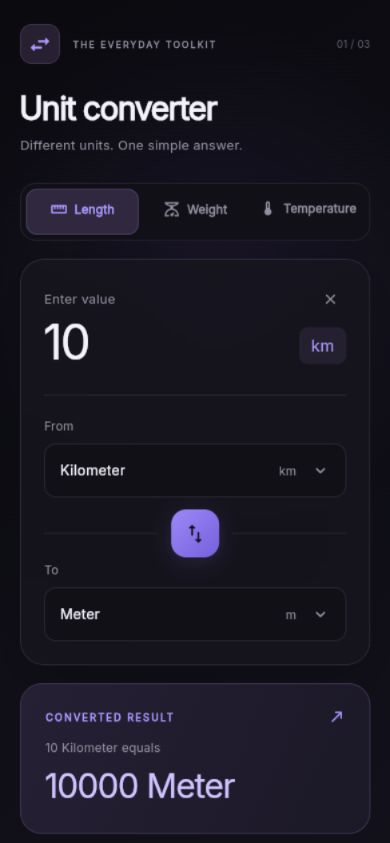

# Unit Converter

A responsive Flutter app for length, weight, and temperature, built with
Material 3, Provider, and a dark violet interface based on the reference layout.

## Features

- Meter ↔ Kilometer, Gram ↔ Kilogram, Celsius ↔ Fahrenheit.
- Live results when typing, changing units, switching categories, or swapping.
- Signed decimal input, safe empty/invalid states, and up to four decimal places.
- Full unit names in results: `10 Kilometer` → `10000 Meter`.
- Glass card, sliding category indicator, rotating swap control, animated results.
- Responsive, keyboard-friendly layout with scrolling on small screens.
- Bundled Inter font; conversions work offline without any API.

## Run

Requires Flutter with Dart 3.13.3 or newer and your target platform's toolchain.

```sh
flutter pub get
flutter run
```

For a browser, use `flutter run -d chrome`. For Windows desktop, use
`flutter run -d windows` with the Flutter Windows development tools installed.

## Verify

```sh
dart format .
flutter analyze
flutter test
```

Tests cover every formula, identity conversions, category safety, formatting,
invalid inputs, overflow, and interactions including the required 10 km example.

## Folder structure

```text
lib/
  main.dart                         Entry point
  app.dart                          MaterialApp and Provider setup
  core/constants/app_constants.dart Shared constants
  core/theme/app_theme.dart         Dark palette and Inter typography
  models/unit_category.dart         Categories and labels
  models/unit_item.dart             Immutable unit model
  services/conversion_service.dart  Pure Dart formulas and supported units
  providers/converter_provider.dart Conversion state and result formatting
  screens/converter_screen.dart     Responsive screen and background
  widgets/                          Input, selector, dropdowns, cards, result
assets/fonts/                       Bundled Inter font and license
test/                               Service, Provider, and widget tests
```

## Screenshot



<!-- Replace this placeholder with a screenshot of the running app. -->
_Screenshot placeholder: `docs/unit-converter.png`._

## Behavior

Starts with `25 Meter → 0.025 Kilometer`. Category changes keep the input and
reset both units. Swap exchanges the units and retains the entered value.
Results round for display only; formulas use doubles. Animations respect the
system's reduced-motion preference.

Only `provider` and `google_fonts` are added as app dependencies. Conversion
logic has no Flutter imports and can be extended in `ConversionService`.
Google Fonts stays on version 8 for compatibility with Flutter's Material theme.
